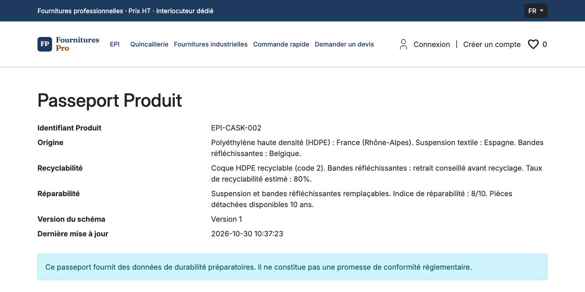
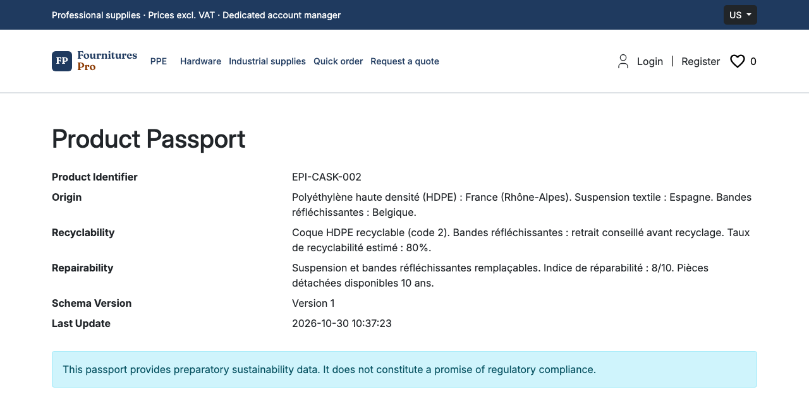

# Plugin Passeport Numérique Produit pour Sylius

[](https://github.com/thibmonier/sylius-digital-product-passport-plugin/actions/workflows/build.yaml)

[🇬🇧 English version](README.md)

Modèle de données de durabilité ouvert et versionné pour les produits Sylius 2 : origine, recyclabilité, réparabilité, avec page publique du passeport.

**Important** : ce plugin fournit un **modèle de données préparatoire** aligné sur le règlement ESPR (UE) 2024/1781. Il ne fait **AUCUNE promesse de conformité réglementaire** tant que les actes délégués par catégorie de produits ne sont pas publiés.

## Fonctionnalités

- **Modèle de données versionné** : un passeport par variante de produit (identifiant produit, origine des matériaux, recyclabilité, réparabilité), avec un numéro de version et un historique des révisions (`PassportRevision`, enregistrées par `PassportRevisionService`).
- **Page publique du passeport** : `/product-passport/{id}`, lisible sans compte, en français et en anglais, avec les données, la version du passeport et la date de dernière mise à jour. Un passeport sans aucune donnée renseignée est considéré comme non publié et renvoie une 404.
- **Lien depuis la fiche produit** : un lien « Passeport Produit » dans le résumé de la fiche produit de la boutique, par le hook Twig `sylius_shop.product.show.content.info.summary`.
- **Export JSON** : `DigitalProductPassport::toJson()` renvoie le passeport avec la version de son schéma (`schemaVersion`).
- **GS1 Digital Link et QR code** : quand l'identifiant produit du passeport est un GTIN valide (8, 12, 13 ou 14 chiffres, clé de contrôle vérifiée), la page d'édition d'un produit en administration affiche un onglet « Étiquettes » avec le lien GS1 Digital Link (`https://id.gs1.org/01/{GTIN}`) et son QR code (SVG). Un GTIN invalide est signalé dans l'onglet.
- **Pièces détachées compatibles** (optionnel) : quand [`tmonier/sylius-customer-asset-management-plugin`](https://github.com/thibmonier/sylius-customer-asset-management-plugin) est installé et que le passeport porte un code de modèle d'équipement, la page publique liste les variantes compatibles avec ce modèle, avec un lien vers leur fiche ; un produit désactivé est listé comme indisponible, sans lien. Sans ce plugin, le bloc n'est pas affiché.
- **Passeport sur la page d'une machine** (optionnel, customer-asset-management ^0.2.1) : sur la page d'une machine du parc du client, un bloc renvoie vers le passeport publié de son modèle d'équipement (même code de modèle) et liste ses pièces compatibles. Un modèle sans passeport publié n'affiche aucun bloc.

Prévu dans des versions ultérieures : une interface d'administration des passeports, le téléchargement du QR code en SVG et PNG, d'autres champs de données.

## Installation

```bash
composer require tmonier/sylius-digital-product-passport-plugin
```

Activer le plugin dans `config/bundles.php` :

```php
return [
    // ...
    Tmonier\SyliusDigitalProductPassportPlugin\TmonierSyliusDigitalProductPassportPlugin::class => ['all' => true],
];
```

Importer les routes, par exemple dans `config/routes/tmonier_digital_product_passport.yaml` :

```yaml
tmonier_digital_product_passport:
    resource: '@TmonierSyliusDigitalProductPassportPlugin/config/routes.yaml'
```

Lancer les migrations :

```bash
bin/console doctrine:migrations:migrate
```

## Utilisation

Il n'y a pas encore d'écran d'administration des passeports : ils se créent par le code (fixtures, import ou commande de votre choix), par exemple :

```php
$passport = new DigitalProductPassport();
$passport->setProductVariant($variant);
$passport->setOriginMaterials('France, Allemagne');
$passport->setRecyclability('100 % recyclable');
$passport->setRepairability('Indice de réparabilité : 8/10');
$passport->setProductIdentifier('01234567890128'); // GTIN, utilisé pour le lien GS1 Digital Link
$passport->setEquipmentModelCode('FORKLIFT_X'); // optionnel, modèle d'équipement de customer-asset-management
$entityManager->persist($passport);
$entityManager->flush();
```

La fiche produit renvoie alors vers la page publique `/product-passport/{id}`.

## Passeport batterie (niveau public)

Règlement (UE) 2023/1542, art. 77(1) : à partir du 18 février 2027, un passeport batterie est exigé pour chaque batterie LMT (moyen de transport léger), chaque batterie industrielle de capacité supérieure à 2 kWh et chaque batterie de véhicule électrique. Les données publiques figurent à l'annexe XIII point 1 (dont l'annexe VI partie A).

Un passeport peut porter un **profil batterie** facultatif (`BatteryProfile`, `$passport->setBatteryProfile()`) ; les passeports sans profil sont inchangés.

- **Obligatoires quand un profil existe** : catégorie (`BatteryCategory` : LMT, industrielle, véhicule électrique, portable, SLI), chimie, capacité nominale (Ah), tension nominale (V), poids (kg), date de fabrication (mois et année).
- **Facultatifs** : tensions minimale et maximale, lieu de fabrication, empreinte carbone (kg CO2e/kWh), contenu recyclé de cobalt, lithium, nickel et plomb (%), part d'énergie renouvelable (%), durée de vie en cycles, substances dangereuses, matières premières critiques, agent d'extinction, durée de garantie.
- **Validation** (Symfony Validator, `validator->validate($passport)`) : un champ obligatoire manquant est refusé avec un message qui le nomme ; les pourcentages doivent être compris entre 0 et 100, les autres valeurs supérieures à 0. Une batterie portable ou SLI est **acceptée** et signalée par un avertissement, « Passeport batterie non obligatoire pour cette catégorie (art. 77(1)) » (`BatteryScopeAdvisor`, affiché aussi sur la page publique). Le seuil de 2 kWh des batteries industrielles n'est pas vérifié.
- **Page publique** : une section « Batterie » en français et en anglais, avec les unités, sous forme de liste de définitions. Une révision (`PassportRevision`) enregistre le profil comme les autres champs.
- **Export JSON** : un passeport avec profil exporte `schemaVersion` 2, soit la version 1 plus un objet `battery`. Un passeport sans profil exporte exactement les clés de la version 1 : les consommateurs existants ne sont pas touchés.

```php
$battery = new BatteryProfile();
$battery->category = BatteryCategory::Industrial;
$battery->chemistry = 'Lithium iron phosphate (LFP)';
$battery->nominalCapacityAh = 600.0;
$battery->nominalVoltageV = 48.0;
$battery->weightKg = 850.0;
$battery->manufacturedOn = new \DateTimeImmutable('2027-03-01'); // seuls le mois et l'année sont affichés
$passport->setBatteryProfile($battery);
```

Hors périmètre : les niveaux d'accès restreints (intérêt légitime, autorités) et le dépôt au registre européen des passeports batterie (art. 77(10)). Le plugin ne fait toujours **aucune promesse de conformité réglementaire**.

## Captures d'écran

Page publique du passeport produit, telle qu'affichée dans la [démo Sylius B2B](https://sylius-b2b.thibaut-monier.fr/fr_FR/plugins). Les intitulés suivent la langue de la boutique ; les valeurs des champs sont affichées telles que saisies.





## Prérequis

- PHP 8.2 ou supérieur
- Sylius 2.2.9+ ou 2.3+
- Symfony 7.4 ou 8.0 (testés en CI)

## Développement

```bash
make install        # Installer les dépendances
make test           # Lancer les tests
make phpstan        # Lancer PHPStan
make ecs            # Vérifier les standards de code
make quality        # Lancer tous les contrôles qualité
```

## Contexte Réglementaire

Ce plugin anticipe l'obligation du Passeport Numérique Produit du règlement ESPR (UE) 2024/1781 :
- **Batteries** : 18 février 2027 (Règlement (UE) 2023/1542, Art. 77)
- **Autres catégories** : calendrier indicatif (textiles T4 2027, meubles 2028, etc.)

**Avertissement** : ce plugin fournit une structure de données préparatoire. Il ne garantit **AUCUNE conformité réglementaire** tant que les actes délégués ne définissent pas les exigences exactes pour chaque catégorie de produits.

## Auteur

[Thibaut Monier](https://www.linkedin.com/in/thibautmonier/) – Delivery Manager IA / Tech Lead

## Licence

Licence MIT. Voir [LICENSE](LICENSE) pour les détails.

## Liens

- [Règlement ESPR](https://eur-lex.europa.eu/eli/reg/2024/1781/oj?locale=fr)
- [Registre DPP](https://single-market-economy.ec.europa.eu/single-market/digital-product-passport_fr)
