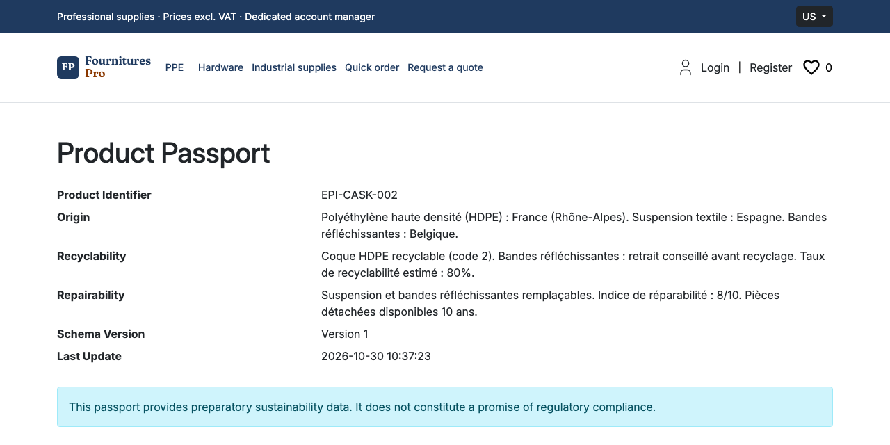
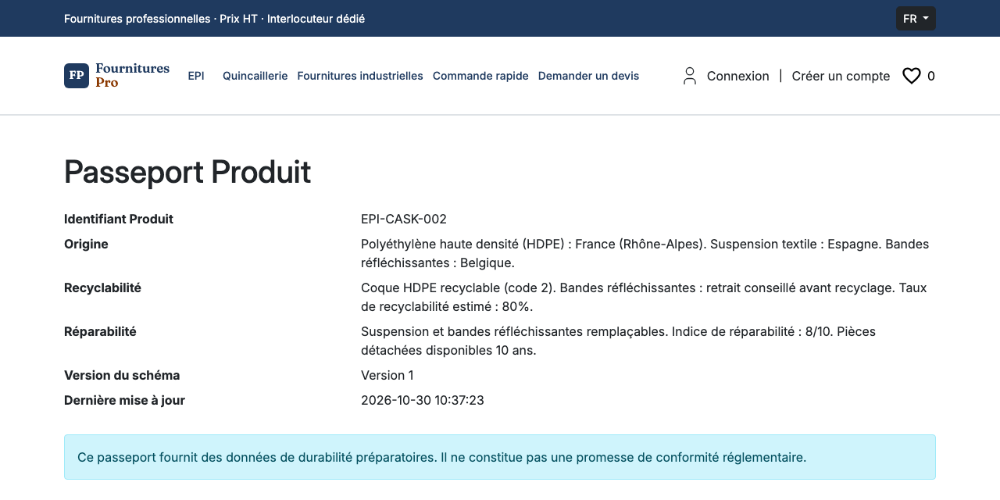

# Digital Product Passport Plugin for Sylius

[](https://github.com/thibmonier/sylius-digital-product-passport-plugin/actions/workflows/build.yaml)

[🇫🇷 Version française](README.fr.md)

Open and versioned sustainability data model for Sylius 2 products: origin, recyclability, repairability, with a public passport page.

**Important**: This plugin provides a **preparatory data model** aligned with ESPR (EU) 2024/1781. It makes **NO promise of regulatory compliance** until delegated acts by product category are published.

## Features

- **Versioned data model**: a passport per product variant (product identifier, origin of materials, recyclability, repairability), with a version number and a revision history (`PassportRevision`, recorded by `PassportRevisionService`).
- **Public passport page**: `/product-passport/{id}`, readable without an account, in English and French, showing the data, the passport version and the date of the last update. A passport with no data filled in is treated as unpublished and returns a 404.
- **Link from the product page**: a "Product Passport" link in the product summary of the shop, through the `sylius_shop.product.show.content.info.summary` Twig hook.
- **JSON export**: `DigitalProductPassport::toJson()` returns the passport with its schema version (`schemaVersion`).

Planned for later versions: an admin interface to edit passports, more data fields, GS1 Digital Link and QR codes.

## Installation

```bash
composer require tmonier/sylius-digital-product-passport-plugin
```

Enable the plugin in `config/bundles.php`:

```php
return [
    // ...
    Tmonier\SyliusDigitalProductPassportPlugin\TmonierSyliusDigitalProductPassportPlugin::class => ['all' => true],
];
```

Import the routes, for example in `config/routes/tmonier_digital_product_passport.yaml`:

```yaml
tmonier_digital_product_passport:
    resource: '@TmonierSyliusDigitalProductPassportPlugin/config/routes.yaml'
```

Run the migrations:

```bash
bin/console doctrine:migrations:migrate
```

## Usage

Version 0.1.0 has no admin screen yet: passports are created in code (fixtures, import or a command of your own), for example:

```php
$passport = new DigitalProductPassport();
$passport->setProductVariant($variant);
$passport->setOriginMaterials('France, Germany');
$passport->setRecyclability('100% recyclable');
$passport->setRepairability('Repairability index: 8/10');
$entityManager->persist($passport);
$entityManager->flush();
```

The product page then links to the public page `/product-passport/{id}`.

## Screenshots

Public product passport page, as rendered in the [Sylius B2B demo](https://sylius-b2b.thibaut-monier.fr/en_US/plugins). Labels follow the shop locale; field values are stored as entered.





## Requirements

- PHP 8.2 or higher
- Sylius 2.2.9+ or 2.3+
- Symfony 7.4 or 8.0 (tested in CI)

## Development

```bash
make install        # Install dependencies
make test           # Run tests
make phpstan        # Run PHPStan
make ecs            # Check coding standards
make quality        # Run all quality checks
```

## Regulatory Context

This plugin anticipates the Digital Product Passport obligation from ESPR (EU) 2024/1781:
- **Batteries**: February 18, 2027 (Regulation (EU) 2023/1542, Art. 77)
- **Other categories**: indicative roadmap (textiles Q4 2027, furniture 2028, etc.)

**Disclaimer**: This plugin provides a preparatory data structure. It makes **NO guarantee of regulatory compliance** until delegated acts define the exact data requirements for each product category.

## Author

[Thibaut Monier](https://www.linkedin.com/in/thibautmonier/) – AI Delivery Manager / Tech Lead

## License

MIT License. See [LICENSE](LICENSE) for details.

## Links

- [ESPR Regulation](https://eur-lex.europa.eu/eli/reg/2024/1781/oj?locale=en)
- [Digital Product Passport Registry](https://single-market-economy.ec.europa.eu/single-market/digital-product-passport_en)
